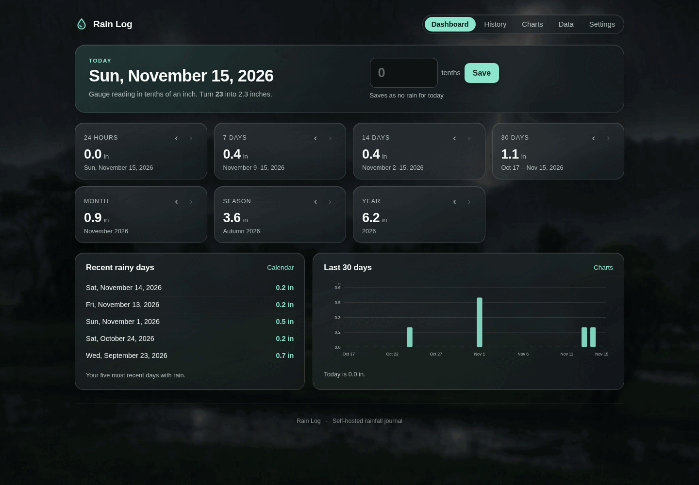
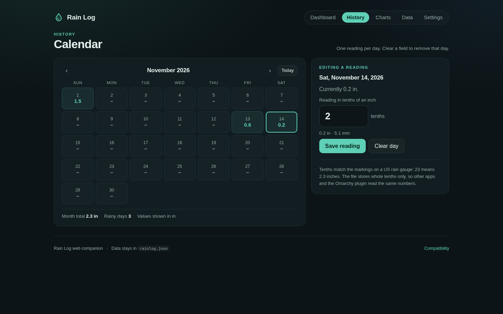
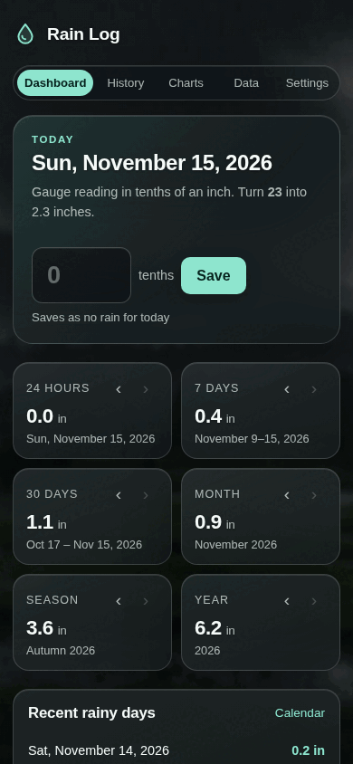
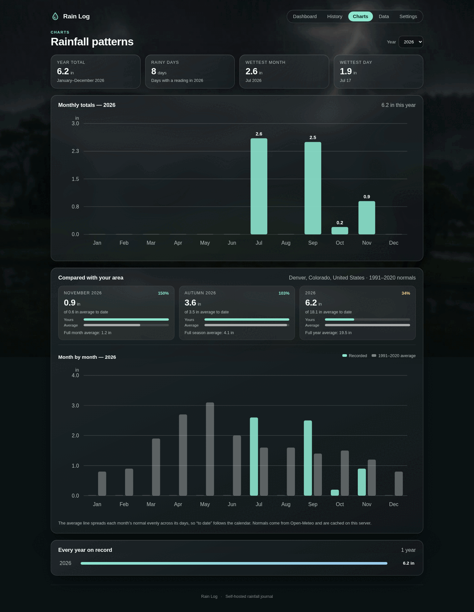
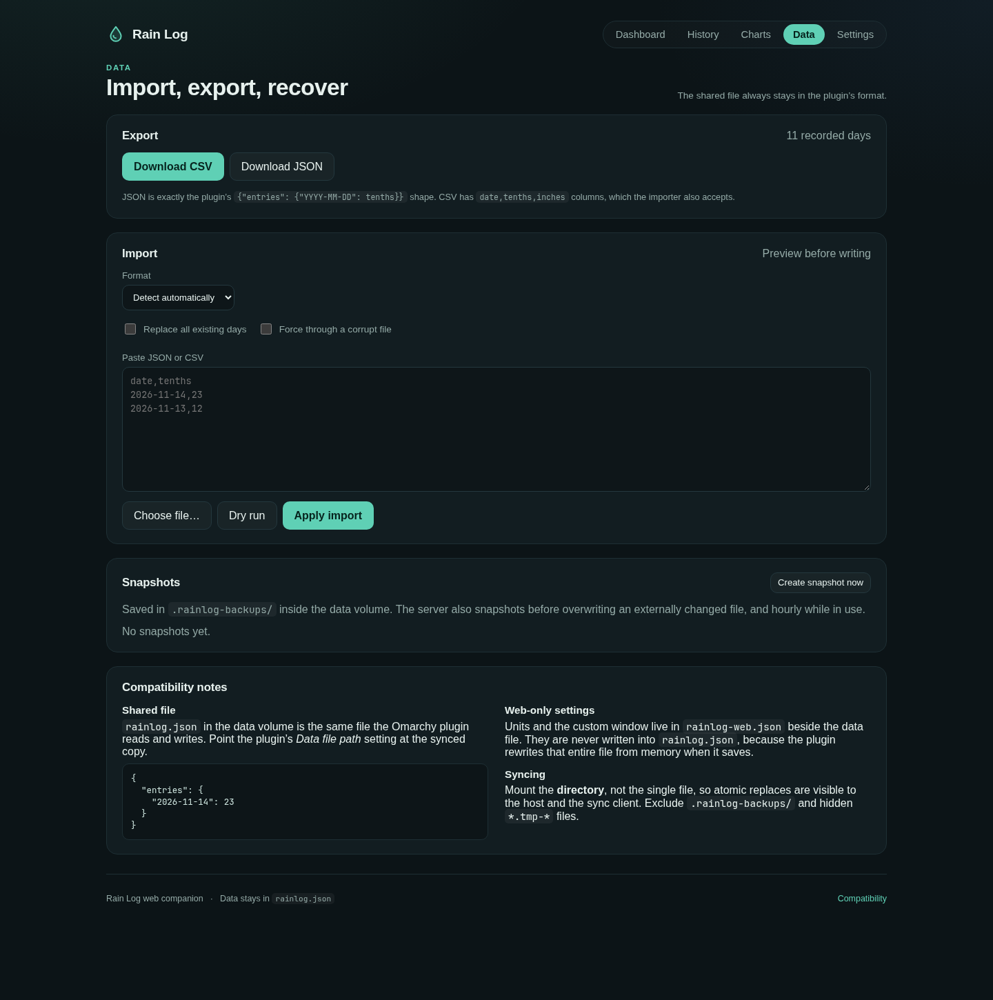
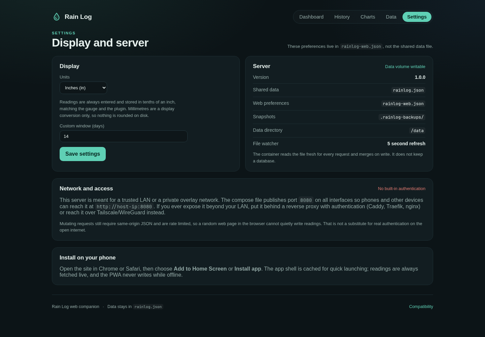

# Rain Log server

A small, self-hosted web companion for the [Rain Log Omarchy plugin](https://github.com/captain-reginald/omarchy-rain-log). It reads and writes the **same `rainlog.json` file** the plugin uses, so a synced folder gives you the bar widget on your desktop and a phone-friendly web app everywhere else.

No database, no accounts, no telemetry. One JSON file, a few flat companion files, and a container.



## What it adds

- **A proper big-screen and phone view** of the same daily readings.
- **Rolling totals** for 24 hours, 72 hours, 7 days, a custom window, the month, and the season, with back/forward stepping.
- **Calendar editing** for catching up on missed days or fixing a typo.
- **Charts**: monthly totals, season-to-date compared with the previous season, and every year on record.
- **CSV and JSON import/export**, with a dry-run preview before anything is written.
- **Automatic snapshots** in `.rainlog-backups/`, plus a snapshot before overwriting a file that changed underneath the server.
- **Optional millimetre display** while keeping every stored value in tenths of an inch.
- **Installable PWA** shell for a home-screen icon; readings are always fetched live.



## Quick start

```bash
git clone https://github.com/captain-reginald/rainlog-server.git
cd rainlog-server
mkdir -p data   # keep it owned by you; Docker would create it as root
docker compose up -d
```

Open `http://<host-ip>:8080` from any device on your LAN, or `http://localhost:8080` on the host.



The compose file publishes port `8080` on all interfaces and mounts `./data` into the container. It defaults to `America/Denver`, `PUID=1000`, and `PGID=1000`.

To build the image yourself instead of pulling `ghcr.io/captain-reginald/rainlog-server:latest`:

```bash
docker compose build
docker compose up -d
```

The directory that contains `rainlog.json` must be writable by `PUID:PGID`. On a typical single-user Linux machine, `id -u` and `id -g` give you the right values. If the directory has different ownership, either change `PUID`/`PGID` or set `RAINLOG_CHOWN=1` once.

A directory that Docker creates on first start is owned by `root`, which the container cannot write. Create `./data` on the host before starting (the cloned repo ships an empty one), or let the container take it over with `RAINLOG_CHOWN=1`.

### Image tags

- `latest` — newest build from `main` or a release tag
- `main` — newest build from `main`
- `v1.0.0`, `1.0`, `1.0.0` — release tags
- Multi-arch: `linux/amd64` and `linux/arm64`

## Pairing it with the Omarchy plugin

The plugin is not modified and does not need to know the server exists. It only needs its **Data file path** setting pointed at the shared file.

1. Pick a folder your sync client already carries, for example `~/Sync/rainlog/`.
2. Put `rainlog.json` there (the plugin creates it on first run if it is missing).
3. Mount that folder as `/data` in the container:
   ```yaml
   volumes:
     - ~/Sync/rainlog:/data
   ```
4. In the plugin’s settings, set **Data file path** to `~/Sync/rainlog/rainlog.json`.
5. Enter a reading on either side. The other side picks it up: the plugin watches the file, and the web app re-reads it every five seconds.

**Mount the directory, not the file.** The server replaces the file atomically (write a temp file, then rename it). A single-file bind mount keeps the old inode, so the host would never see the update.

The plugin’s watcher was verified against Quickshell 0.3.2: both in-place writes and replace-by-rename trigger a reload, including repeated renames in a row.

## Data compatibility

`rainlog.json` is exactly the plugin’s format:

```json
{
  "entries": {
    "2026-11-14": 23,
    "2026-11-13": 12
  }
}
```

The rules the server enforces:

| Rule | Behaviour |
| --- | --- |
| Date keys | Local calendar dates in `YYYY-MM-DD`, validated as real days |
| Values | Whole integers, **tenths of an inch**, from 1 to 9999 |
| No rain | The key is absent; `0` and blank input delete the entry |
| Writing | Re-read, merge only the touched days, write with a temp file + `rename` + `fsync` |
| Formatting | Two-space JSON, keys sorted, no trailing newline — small diffs for syncing |
| Unknown data | Top-level keys and untouched entries are preserved, even though the plugin would drop extra top-level keys itself |
| Corruption | Invalid JSON is reported and writes are refused, so the server never silently replaces it |

Web-only preferences live in `rainlog-web.json` next to the data file. They are **never** stored inside `rainlog.json`, because the plugin rewrites that entire file from memory whenever it saves.

Concurrent editing is best avoided: the plugin has no locking and will replace the whole file with its in-memory copy. The server narrows the window by re-reading and merging immediately before each write, and it snapshots before overwriting a file that changed externally. If you use a sync service, let it settle before editing from two devices at once.

### Import and export formats

- **JSON** — the plugin shape, `{ "entries": { "YYYY-MM-DD": tenths } }`, a plain date map, or an array of `{ date, tenths }` / `{ date, inches }` rows.
- **CSV** — `date,tenths,inches` with a header, or just `date,tenths`; an `inches` column is converted and rounded to the nearest tenth.

Imports merge day by day by default. **Replace all** discards days not in the import; **Force** is only needed to recover a file that is not valid JSON.

## Syncing notes

The data directory is designed for Syncthing, Resilio, a Git repo, or any similar tool. Keep sync artifacts out of version history:

Syncthing `.stignore` example:

```text
.rainlog-backups
.rainlog.json.tmp-*
.rainlog-web.json.tmp-*
```

The server lists Syncthing `*.sync-conflict-*.json` copies on the **Data** page so you know to compare them. It never reads or deletes those files.

Snapshots live in `.rainlog-backups/`. One is taken at most hourly while in use, when a manual snapshot is requested, before a restore, and before overwriting an externally changed file. Retention defaults to 100 files.

## Charts and history



Seasons are meteorological: December–February, March–May, June–August, September–November. Weeks are the last seven calendar days including today. The custom window defaults to 14 days. All period math runs in the browser using explicit date keys, so the container’s timezone cannot shift “today” relative to the plugin.

## Settings and data recovery



The Data page handles export, import, snapshots, and conflict detection. Settings covers inches vs millimetres, the custom window length, and server status.



Millimetres are display-only. A reading is always entered as tenths of an inch, exactly as it is stored, so no precision is lost to a unit round-trip.

## Configuration

| Variable | Default | Purpose |
| --- | --- | --- |
| `PUID` / `PGID` | `1000` | User/group the server runs as inside the container |
| `TZ` | `America/Denver` (compose) | Container timezone; affects log timestamps and snapshot/server dates |
| `RAINLOG_PORT` | `8080` | HTTP port |
| `RAINLOG_HOST` | `0.0.0.0` | Bind address |
| `RAINLOG_DATA_DIR` | `/data` in the image | Directory containing `rainlog.json` |
| `RAINLOG_SNAPSHOT_RETENTION` | `100` | Number of snapshots kept |
| `RAINLOG_SNAPSHOT_INTERVAL` | `3600` | Seconds between automatic snapshots; `0` disables them |
| `RAINLOG_TRUST_PROXY` | `false` | Trust `X-Forwarded-*` headers from a reverse proxy |
| `RAINLOG_CHOWN` | `0` | Set to `1` to let the entrypoint take ownership of the data directory |
| `RAINLOG_VERSION` | build value | Version reported by `/api/health` and the Settings page |

The image is small, runs as a non-root user, uses `tini` as PID 1, and serves a health check at `/api/health`.

## HTTP API

Everything the UI does is available as JSON:

| Method | Path | Notes |
| --- | --- | --- |
| `GET` | `/api/state` | Entries, ETag, preferences, parse errors, conflict copies |
| `PUT` | `/api/entries/:date` | `{ "tenths": 23 }` or `{ "tenths": null }`; optional `If-Match` |
| `POST` | `/api/import` | `{ content, format, dryRun, replaceAll, ifMatch, force }` |
| `GET` | `/api/export.json` / `/api/export.csv` | Download the merged entries |
| `GET` / `PUT` | `/api/preferences` | `{ units, customDays }` |
| `GET` / `POST` | `/api/snapshots` | List, or create a manual snapshot |
| `GET` | `/api/snapshots/:name` | Download a snapshot |
| `POST` | `/api/snapshots/:name/restore` | Snapshot the current file, then restore |
| `GET` | `/api/health` | Health and data-volume writability |

A stale `If-Match` returns `409` with the current state. If the target day did not change, the server merges the write; if it did, the UI reloads and asks you to retry.

## Security

**There is no built-in authentication.** That is deliberate: this is built for a trusted LAN or a private overlay network such as Tailscale or WireGuard.

- The compose file binds `0.0.0.0:8080` so phones can reach it. Do not forward that port from the internet.
- If you need remote access beyond a VPN, put the container behind a reverse proxy that authenticates (Caddy, Traefik, nginx) and set `RAINLOG_TRUST_PROXY=1`.
- Mutating endpoints require `application/json`, reject cross-origin browser requests, cap request size, and rate limit writes. That stops drive-by writes from a random web page; it is not a replacement for authentication.

## Development

```bash
npm install
npm run dev
```

- API and built frontend: <http://localhost:8080>
- Vite dev server: <http://localhost:5173> (proxies `/api` to `8080`)
- Local data defaults to `./data`; use `RAINLOG_DATA_DIR=/path/to/folder` to point elsewhere.

Useful commands:

```bash
npm run typecheck
npm test
npm run build
npm start
```

Tests cover the storage contract (including plugin-shaped files, stale-write merging, corruption, snapshots), the importers, and the HTTP API. A Docker smoke test runs in CI.

`npm audit --omit=dev` reports zero vulnerabilities. A full audit still lists advisories in `workbox-build`'s glob/deepmerge chain, which only runs while building the service worker and has no patched upstream release yet; none of it ships at runtime.

### Repository layout

```text
.
├── server/                 Fastify + TypeScript API and storage
│   ├── src/
│   └── test/
├── web/                    React + Vite frontend (PWA)
├── docker/entrypoint.sh    PUID/PGID handling
├── fixtures/               Synthetic sample data
├── screenshots/
├── Dockerfile
├── compose.yaml
└── .github/workflows/      Tests, multi-arch GHCR publish, releases
```

## License

Rain Log server is free software: you can redistribute it and/or modify it under the terms of the GNU General Public License as published by the Free Software Foundation, either version 3 of the License, or (at your option) any later version.

It is distributed in the hope that it will be useful, but **without any warranty**; without even the implied warranty of merchantability or fitness for a particular purpose. See [LICENSE](LICENSE) for the full text.

Copyright © 2026 Captain Reginald.
